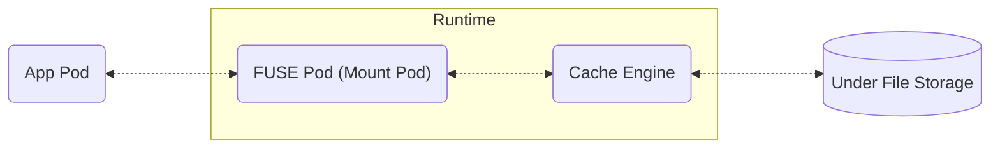
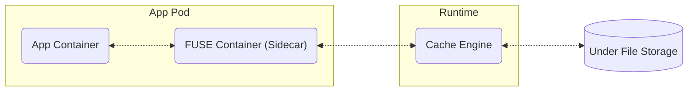

import Tabs from '@theme/Tabs';
import TabItem from '@theme/TabItem';

# Mount Datasets

<span className="badge badge--secondary runtime-compatibility">Applies to: AlluxioRuntime, JindoRuntime, JuiceFSRuntime, ThinRuntime</span>

For each Dataset bound to a Runtime, Fluid automatically creates a PersistentVolumeClaim (PVC) and a PersistentVolume (PV). Application pods can use the PVC created by Fluid as a volume, which mounts the file system of the Runtime to a specified directory in the container. In this way, containers can access the files in the underlying storage systems defined in the Dataset through the Runtime, just like accessing local files.

Fluid supports two mount modes: **the MountPod mode and the Sidecar mode**. This document describes how to access the data in a Dataset with both mount modes.

## Create Application Pods to Access Data

:::info[Prerequisites]

This section assumes that you have created a Dataset bound to a Runtime (that is, `status.phase==Bound`) in the cluster, and Fluid has created a PVC for the Dataset. For how to do this, see the documents about deploying Runtimes, such as [Deploy Alluxio with AlluxioRuntime](/tutorials/runtimes/alluxio.md).

:::

Assume that the cluster has the following PVC named `mydataset`, which was created by Fluid:

```shell
$ kubectl get pvc
```

The output is similar to:

```
NAME        STATUS   VOLUME              CAPACITY   ACCESS MODES   STORAGECLASS   VOLUMEATTRIBUTESCLASS   AGE
mydataset   Bound    default-mydataset   100Pi      ROX            fluid          <unset>                 157m
```

Create an application pod that mounts the PVC in the mount mode you need:

<Tabs groupId="mount-mode">
<TabItem value="MountPod" label="MountPod">

```yaml title="pod.yaml"
apiVersion: v1
kind: Pod
metadata:
  name: nginx
spec:
  restartPolicy: Always
  containers:
    - name: demo
      image: nginx
      volumeMounts:
        - mountPath: /data/
          name: data-vol
  volumes:
    - name: data-vol
      persistentVolumeClaim:
        claimName: mydataset # PVC's name is same as Dataset's name
```

The application pod above mounts the PVC `mydataset` (that is, the file system of the Runtime bound to the Dataset) to the `/data` directory in its container.

In the MountPod mode, you only need to mount the PVC that has the same name as the Dataset to the specified path in the container as a volume.

</TabItem>
<TabItem value="Sidecar" label="Sidecar">

```yaml title="pod.yaml"
apiVersion: v1
kind: Pod
metadata:
  name: nginx
  labels:
    serverless.fluid.io/inject: "true"
spec:
  restartPolicy: Always
  containers:
    - name: demo
      image: nginx
      volumeMounts:
        - mountPath: /data/
          name: data-vol
  volumes:
    - name: data-vol
      persistentVolumeClaim:
        claimName: mydataset # PVC's name is same as Dataset's name
```

The application pod above mounts the PVC `mydataset` (that is, the file system of the Runtime bound to the Dataset) to the `/data` directory in its container.

In the Sidecar mode, besides mounting the PVC that has the same name as the Dataset to the specified path in the container, you also need to add the label `serverless.fluid.io/inject=true` to `Pod.metadata.labels`. When a pod with this label is created, Fluid automatically converts the PVC in the pod into a sidecar container, which provides the file system mount point to the other application containers in the pod.

</TabItem>
</Tabs>

Run the following command to create the application pod:

```shell
$ kubectl create -f pod.yaml
```

Finally, log in to the application pod to verify that the data in the Dataset can be read:

```shell
$ kubectl exec -it nginx -c demo -- ls -l /data/
```

If everything works, you will see the directory structure of the underlying storage system under the `/data/` directory.

## About Mount Modes

<Tabs groupId="mount-mode">
<TabItem value="MountPod" label="MountPod">

In the MountPod mode, the data access architecture is as follows:



The FUSE pod creates a file system mount point that can be shared on the node with [Filesystem in Userspace (FUSE)](https://www.kernel.org/doc/html/next/filesystems/fuse.html). When an application pod is scheduled to a node, Fluid creates a FUSE pod on the node on demand (that is, when there is no FUSE pod on the node). If multiple application pods access the same Dataset on the same node, they share the same FUSE client, which means that they naturally share the performance gains of the client cache. For when FUSE pods are cleaned up, see [FUSE Pod Clean Policy](/tutorials/data-accessing/fuse-pod-clean-policy.md).

</TabItem>
<TabItem value="Sidecar" label="Sidecar">

In the Sidecar mode, the data access architecture is as follows:



When an application pod is created, Fluid injects a FUSE container into it as a sidecar container. The FUSE container starts first, and creates a file system mount point that can be shared in the pod with [Filesystem in Userspace (FUSE)](https://www.kernel.org/doc/html/next/filesystems/fuse.html). If an application pod accesses multiple Datasets, a sidecar container is injected for each Dataset. If multiple application pods access the same Dataset, each pod uses its own FUSE client. This provides stronger isolation, but loses the chance to share the client cache.

The Sidecar mode also works in environments where FUSE pods cannot run on nodes, such as serverless Kubernetes. See [How to Run in Knative Environment](/tutorials/advanced/serverless/how-to-run-in-knative-environment.md).

</TabItem>
</Tabs>

## Resources of FUSE Pods and Sidecars

FUSE converts the requests of applications to access local directories into data access requests to the Runtime, so the resource limits of FUSE pods and sidecar containers also affect the data access performance perceived by applications. To change the resource requests and limits of FUSE pods and sidecar containers, modify the Runtime as follows:

```yaml title="runtime.yaml"
apiVersion: data.fluid.io/v1alpha1
kind: XXXRuntime  # Replace with your Runtime Kind.
metadata:
  name: mydataset # MUST be same as Dataset's name
  namespace: default
spec:
  ...
  fuse:
    resources:
      requests:
        cpu: 4
        memory: 8Gi
      limits:
        cpu: 8
        # memory: 16Gi
```

:::warning

The file system mount point created by FUSE relies on the FUSE process running in the container to handle data. If the FUSE process crashes, application pods cannot access data anymore. Therefore, we recommend setting the memory limit of FUSE pods (`spec.fuse.resources.limits.memory`) to a value larger than expected (or leaving it empty) to avoid the business impact caused by OOM.

:::
