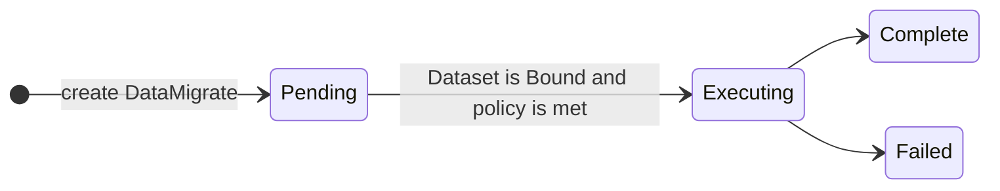
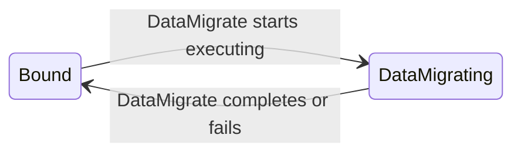

# Data Migrate

Fluid provides the data migrate operation (DataMigrate) to describe data synchronization between data sources. Currently, it is only supported by JuiceFSRuntime, and is used to migrate data between a JuiceFS file system and an external storage system (such as S3 and HDFS).

## Migrate Data with JuiceFSRuntime

<span className="badge badge--secondary runtime-compatibility">Applies to: JuiceFSRuntime</span>

JuiceFS is essentially a POSIX-compatible file system. If your existing data is stored in a storage system other than JuiceFS, you need to import the data into JuiceFS first. This section describes how to migrate data between JuiceFS and external storage systems with DataMigrate.

:::info[Prerequisites]

This section assumes that you have created a Dataset bound to a JuiceFSRuntime (that is, `status.phase==Bound`) in the cluster. For how to do this, see [Deploy JuiceFS with JuiceFSRuntime](/tutorials/runtimes/juicefs.md).

:::

### Migrate Data

After the Dataset is ready (`Bound`), you can migrate data with DataMigrate. An example of DataMigrate:

```yaml title="datamigrate.yaml"
apiVersion: data.fluid.io/v1alpha1
kind: DataMigrate
metadata:
  name: jfs-migrate
spec:
  image: registry.cn-hangzhou.aliyuncs.com/juicefs/juicefs-fuse
  imageTag: nightly
  from:
    externalStorage:
      uri: minio://minio.default.svc.cluster.local:9000/test/
      encryptOptions:
        - name: access-key
          valueFrom:
            secretKeyRef:
              name: jfs-secret
              key: accesskey
        - name: secret-key
          valueFrom:
            secretKeyRef:
              name: jfs-secret
              key: secretkey
  to:
    dataset:
      name: jfsdemo
      namespace: default
      path: /dir1
  options:
    "exclude": "4.png"
```

Where:

- `spec.image`: The image of the job that migrates data.
- `spec.imageTag`: The image tag of the job that migrates data.
- `spec.from`/`spec.to`: The source and the destination of the data migration.
- `spec.from(/to).externalStorage`: The data to migrate is in an external storage system, such as OSS and S3.
- `spec.from(/to).externalStorage.uri`: The URI of the external storage system.
- `spec.from(/to).externalStorage.encryptOptions`: The sensitive parameters of the external storage system. `access-key` and `secret-key` are fixed names, which stand for the AccessKey pair of the object storage.
- `spec.from(/to).dataset`: The data to migrate is in a Dataset.
- `spec.from(/to).dataset.name`: The name of the Dataset.
- `spec.from(/to).dataset.namespace`: The namespace of the Dataset.
- `spec.from(/to).dataset.path`: The subpath in the Dataset.
- `spec.options`: The options of `juicefs sync`. For details, see the [JuiceFS documentation](https://juicefs.com/docs/community/command_reference#sync).

[Distributed sync](https://juicefs.com/docs/community/guide/sync#distributed-sync): When a large amount of data is synced, the bandwidth of a single machine often becomes the bottleneck. In this case, DataMigrate supports syncing data with multiple pods concurrently (with node anti-affinity between the pods). The related parameters are:

- `spec.parallelism`: The total number of workers for syncing data. Defaults to 1.
- `spec.parallelOptions`: The parameters for concurrent syncing when `spec.parallelism` is greater than 1. Currently supported parameters:
  - `sshSecretName`: Required, no default value. The name of the Secret that configures passwordless SSH between the workers. The Secret must contain `ssh-privatekey` and `ssh-publickey`.
  - `sshPort`: Optional, defaults to 22. The SSH port of the workers.
  - `sshReadyTimeoutSeconds`: Optional, defaults to 180. The timeout for waiting for the SSH connections of all workers to be ready.

### Migrate Data from PVCs

DataMigrate also supports using a PVC as the data source. Prepare the PVC that holds the data to migrate, and Fluid mounts the PVC into the job that runs the DataMigrate. An example of DataMigrate with a PVC named `oss-pvc`:

```yaml title="datamigrate.yaml"
apiVersion: data.fluid.io/v1alpha1
kind: DataMigrate
metadata:
  name: jfs-migrate
spec:
  from:
    externalStorage:
      uri: pvc://oss-pvc/subpath
  to:
    dataset:
      name: jfsdemo
      namespace: default
```

You only need to specify the name of the PVC in the URI, in the format of `pvc://<pvc-name>/<subpath>`.

### Migrate Data Periodically

DataMigrate supports migrating data periodically according to a schedule in the Cron format. An example configuration:

```yaml title="datamigrate.yaml"
apiVersion: data.fluid.io/v1alpha1
kind: DataMigrate
metadata:
  name: jfs-cron-migrate
spec:
  image: registry.cn-hangzhou.aliyuncs.com/juicefs/juicefs-fuse
  imageTag: nightly
  policy: Cron
  # migrate data every 10 minutes
  schedule: "*/10 * * * *"
  from:
    externalStorage:
      uri: minio://minio.default.svc.cluster.local:9000/test/
  to:
    dataset:
      name: jfsdemo
      namespace: default
      path: /dir1
```

- `spec.policy`: Set to `Cron` to run the DataMigrate periodically.
- `spec.schedule`: The schedule in the Cron format. Required when `spec.policy` is `Cron`.

Distributed periodic migration: Periodic migration can also be used together with distributed sync. It is implemented with the `SuspendJob` feature, so it has requirements on the Kubernetes version:

- Kubernetes earlier than 1.21: Distributed periodic migration is not supported.
- Kubernetes 1.21: `SuspendJob` is an alpha feature. Distributed periodic migration can only be used after the `SuspendJob` feature gate is enabled explicitly.
- Kubernetes later than 1.21: The `SuspendJob` feature gate is enabled by default, and distributed periodic migration is supported.

## Lifecycle of DataMigrate

The phase of a DataMigrate changes as follows:



1. After a DataMigrate is created, its phase is `Pending`.
2. A DataMigrate runs only when the Dataset is `Bound` and its policy is met (for example, the scheduled time comes).
3. When the data migration starts, the phase changes from `Pending` to `Executing`.
4. If the migration succeeds, the phase changes to `Complete`. Otherwise, it changes to `Failed`.

The phase of the Dataset changes as follows:



1. While a DataMigrate is running, the phase of the Dataset is `DataMigrating`, which means that data is being migrated. Do not update the data in the Dataset during the migration, otherwise the data may become inconsistent.
2. After the DataMigrate completes or fails, the phase of the Dataset changes back to `Bound`.
