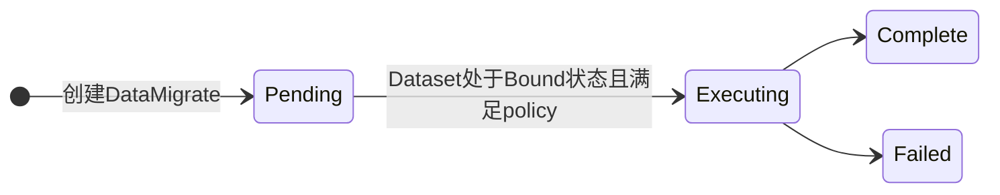
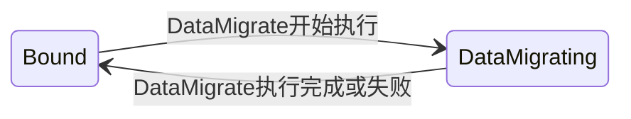

# 数据迁移

Fluid提供了数据迁移（DataMigrate）操作来描述多个数据源之间的数据同步。该功能目前仅支持在JuiceFSRuntime上使用，用于迁移JuiceFS文件系统和外部数据源（如S3、HDFS等存储）之间的数据。

## JuiceFSRuntime数据迁移 {#migrate-data-with-juicefsruntime}

<span className="badge badge--secondary runtime-compatibility">功能适用于：JuiceFSRuntime</span>

JuiceFS本质是一个POSIX兼容的文件系统。如果存量数据存在JuiceFS以外的外部存储系统中，需要先将数据导入到JuiceFS中。本节讲述如何使用DataMigrate数据操作实现JuiceFS与外部存储之间的数据迁移。

:::info[前提条件]

本节假设你已经在集群中创建了一个与JuiceFSRuntime绑定的Dataset（即`status.phase==Bound`）。该前置过程请参考[使用JuiceFSRuntime部署JuiceFS](/tutorials/runtimes/juicefs.md)。

:::

### 数据迁移 {#migrate-data}

在Dataset可用（`Bound`状态）之后，接下来可以通过DataMigrate迁移数据。以下是一个DataMigrate的示例：

```yaml title="datamigrate.yaml"
apiVersion: data.fluid.io/v1alpha1
kind: DataMigrate
metadata:
  name: jfs-migrate
spec:
  image: registry.cn-hangzhou.aliyuncs.com/juicefs/juicefs-fuse
  imageTag: nightly
  from:
    externalStorage:
      uri: minio://minio.default.svc.cluster.local:9000/test/
      encryptOptions:
        - name: access-key
          valueFrom:
            secretKeyRef:
              name: jfs-secret
              key: accesskey
        - name: secret-key
          valueFrom:
            secretKeyRef:
              name: jfs-secret
              key: secretkey
  to:
    dataset:
      name: jfsdemo
      namespace: default
      path: /dir1
  options:
    "exclude": "4.png"
```

其中：

- `spec.image`：指定数据迁移的Job使用的镜像；
- `spec.imageTag`：指定数据迁移的Job使用的镜像的Tag；
- `spec.from`/`spec.to`：指定数据迁移的源和目标；
- `spec.from(/to).externalStorage`：表明需要迁移的数据是外部的存储，可以是OSS、S3等；
- `spec.from(/to).externalStorage.uri`：外部存储的URI；
- `spec.from(/to).externalStorage.encryptOptions`：外部存储的加密参数，`access-key`、`secret-key`是固定名称，表示对象存储的AccessKey（AK/SK）；
- `spec.from(/to).dataset`：表明需要迁移数据的Dataset；
- `spec.from(/to).dataset.name`：需要迁移数据的Dataset的名称；
- `spec.from(/to).dataset.namespace`：需要迁移数据的Dataset的命名空间；
- `spec.from(/to).dataset.path`：需要迁移数据的Dataset的子路径；
- `spec.options`：`juicefs sync`的参数，具体请参考[JuiceFS文档](https://juicefs.com/docs/zh/community/command_reference#juicefs-sync)。

[分布式同步](https://juicefs.com/docs/zh/community/guide/sync#distributed-sync)：在同步大量数据时，单机带宽往往会被占满出现瓶颈，针对这种情况，DataMigrate提供多Pod并发同步支持（Pod彼此间具备节点反亲和性），相关参数如下：

- `spec.parallelism`：启动用于同步的Worker的总数量，默认为1；
- `spec.parallelOptions`：当`spec.parallelism`大于1时，用于设置并发同步的相关参数，当前支持：
  - `sshSecretName`：必选，无默认值，Workers间的SSH免密配置的Secret的名称，Secret中必须包含`ssh-privatekey`和`ssh-publickey`；
  - `sshPort`：可选，默认22，Workers间的SSH端口；
  - `sshReadyTimeoutSeconds`：可选，默认180，等待所有Workers都准备好SSH连接前的超时时间。

### 基于PVC的DataMigrate {#migrate-data-from-pvcs}

DataMigrate还支持以PVC的形式作为数据源，需要额外准备需要迁移的PVC，Fluid会将已有的PVC挂载到执行DataMigrate的Job中。以下是一个DataMigrate的示例，PVC名为`oss-pvc`：

```yaml title="datamigrate.yaml"
apiVersion: data.fluid.io/v1alpha1
kind: DataMigrate
metadata:
  name: jfs-migrate
spec:
  from:
    externalStorage:
      uri: pvc://oss-pvc/subpath
  to:
    dataset:
      name: jfsdemo
      namespace: default
```

只需要在URI中声明PVC的名称即可，格式为`pvc://<pvc-name>/<subpath>`。

### 定时迁移 {#migrate-data-periodically}

DataMigrate可以通过Cron表达式支持定时迁移的策略，下面是一个示例配置：

```yaml title="datamigrate.yaml"
apiVersion: data.fluid.io/v1alpha1
kind: DataMigrate
metadata:
  name: jfs-cron-migrate
spec:
  image: registry.cn-hangzhou.aliyuncs.com/juicefs/juicefs-fuse
  imageTag: nightly
  policy: Cron
  # 每10分钟执行一次数据迁移任务
  schedule: "*/10 * * * *"
  from:
    externalStorage:
      uri: minio://minio.default.svc.cluster.local:9000/test/
  to:
    dataset:
      name: jfsdemo
      namespace: default
      path: /dir1
```

- `spec.policy`：配置成`Cron`时，表明为定时任务；
- `spec.schedule`：Cron表达式，当`spec.policy`为`Cron`时必须配置该字段。

分布式定时迁移：定时迁移也可以跟分布式同步结合使用，其原理是通过`SuspendJob`特性实现，因此对Kubernetes版本有要求：

- Kubernetes版本小于1.21，不支持分布式定时迁移；
- Kubernetes版本等于1.21，`SuspendJob`处于alpha阶段，需要显式配置启用`SuspendJob`特性开关才可以使用分布式定时迁移；
- Kubernetes版本大于1.21，`SuspendJob`特性开关默认启用，支持分布式定时迁移。

## DataMigrate生命周期 {#lifecycle-of-datamigrate}

DataMigrate的状态转换流程如下：



1. DataMigrate创建后，状态为`Pending`；
2. 只有当Dataset状态为`Bound`且满足policy（例如到达定时执行的时间）时，DataMigrate才能运行；
3. 运行数据迁移时，状态从`Pending`置为`Executing`；
4. 运行成功后状态变为`Complete`；运行失败则状态变为`Failed`。

Dataset的状态转换流程如下：



1. DataMigrate执行时，Dataset状态为`DataMigrating`，表示此时正在迁移数据，不可进行数据更新，否则会有数据不一致的风险。
2. DataMigrate执行完成或失败后，Dataset状态恢复为`Bound`。
